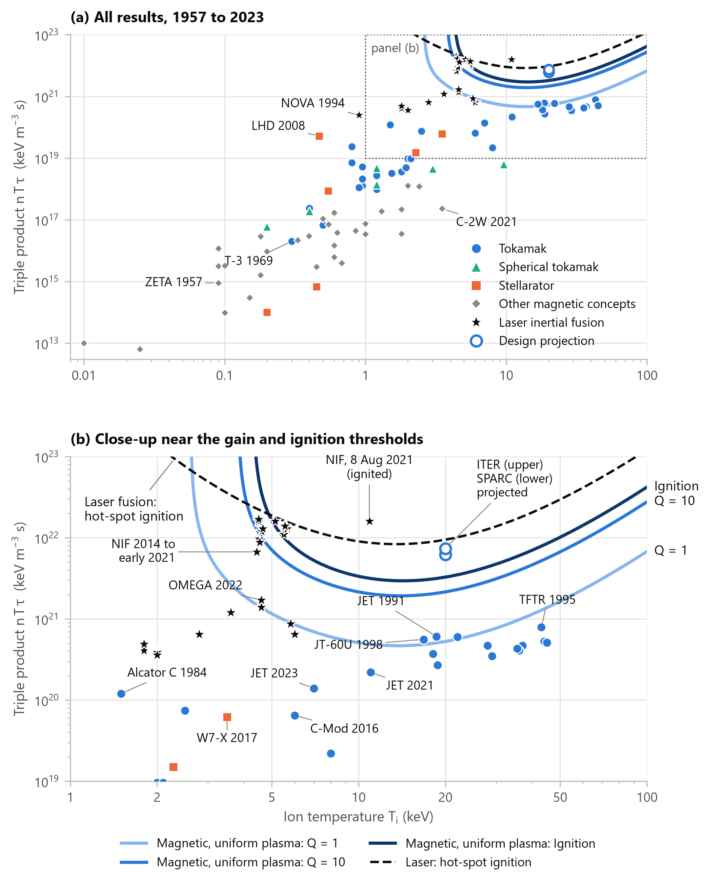

# Lawson criteria for D-T fusion: reproduction and sensitivity analysis

**Author:** Ekorshi Paul Choudhury, Department of Mathematics and Computing, Sri Mata Vaishno Devi University &nbsp;|&nbsp; **Report:** [report/report.pdf](report/report.pdf) &nbsp;|&nbsp; **Interactive site:** [anonnuserr.github.io/ignition-lab](https://anonnuserr.github.io/ignition-lab/)

A small, tested Python project that calculates the conditions a deuterium-tritium
plasma must reach to produce net fusion energy, validates them against published
values, places 103 real experimental results against those conditions, and
quantifies how impurities and fuel mix move the ignition threshold.

It also includes **Ignition Lab**, an interactive website (in `docs/`) with two
tools built on the same tested physics: a Lawson explorer, and a reactor designer
that reproduces the published performance projections of SPARC and ITER.



## What it does

1. **Reactivity.** Implements the Bosch-Hale D-T reactivity fit and, independently,
   a Maxwellian integral of the Bosch-Hale cross-section. The two agree to within
   0.8% from 0.5 to 100 keV.
2. **Lawson criteria.** Solves the steady-state power balance for the Lawson
   parameter and triple product required for any fuel gain, including ignition.
3. **Experiments.** Compares 103 results from 54 devices (1957 to 2023, plus the
   ITER and SPARC projections) with the calculated thresholds.
4. **Sensitivity.** Extends the model to helium ash, low-Z impurities and an
   unequal fuel mix, and measures the error of the common textbook shortcut.

## Validation against published values

Reference: Wurzel & Hsu, *Phys. Plasmas* **29**, 062103 (2022), Tables 2 and 3.

| Quantity (50:50 D-T, uniform plasma) | This work | Published |
|---|---|---|
| Ideal ignition temperature | 4.30 keV | 4.3 keV |
| Minimum n&tau; for fuel gain Q = 1 | 2.52 &times; 10<sup>19</sup> m<sup>-3</sup> s at 25.7 keV | 2.5 &times; 10<sup>19</sup> at 26 keV |
| Minimum n&tau; for ignition | 1.56 &times; 10<sup>20</sup> m<sup>-3</sup> s at 26.0 keV | 1.6 &times; 10<sup>20</sup> at 26 keV |
| Minimum nT&tau; for Q = 1 | 4.67 &times; 10<sup>20</sup> keV m<sup>-3</sup> s at 13.7 keV | 4.6 &times; 10<sup>20</sup> at 14 keV |
| Minimum nT&tau; for ignition | 2.95 &times; 10<sup>21</sup> keV m<sup>-3</sup> s at 14.2 keV | 2.9 &times; 10<sup>21</sup> at 14 keV |

The residual differences (under 2%) come from two-significant-figure rounding in
the reference and from its use of directly integrated cross-sections. Repeating
the calculation with integrated cross-sections gives 2.93 &times; 10<sup>21</sup>
for the ignition triple product. All values are regenerated in
`results/summary.json`.

## Main findings

* The best tokamak results (JET 1991, JT-60U 1998) reached about 19% of the
  Lawson parameter needed for ignition at their own temperature, under the
  uniform-plasma model.
* Applied to laser fusion, the model places exactly one shot above the hot-spot
  ignition threshold: NIF N210808 (8 August 2021), the shot reported to have ignited.
* 10% helium ash raises the ignition triple product by 57%; 2% carbon raises it by 31%.
* A 40:60 fuel mix costs only 4%; a 30:70 mix costs 20%.
* The shortcut &lang;&sigma;v&rang; = 1.1 &times; 10<sup>-24</sup> T<sup>2</sup>
  is off by up to 10.5% inside its 10-20 keV window and overestimates the
  ignition triple product by 5%.

## Limitations

* Uniform (flat) density and temperature profiles, with T<sub>i</sub> = T<sub>e</sub>.
  Experimental points use peak values, so the comparison is indicative only.
* Bremsstrahlung is the only radiation loss; line and synchrotron radiation are
  neglected, so impurity penalties are lower bounds. High-Z impurities such as
  tungsten are not modelled.
* Most experiments used deuterium or hydrogen, not D-T; their points are
  D-T-equivalent values as tabulated in the source.
* This is a reproduction with a small original analysis, not new physics.

## Ignition Lab: the interactive site

`docs/` is a static website that runs entirely in the browser. It has three parts.

1. **Lawson explorer.** Sliders for temperature, density, confinement time and
   fuel purity. It shows the fuel gain, the share of the ignition requirement
   reached and where the power goes, and places the plasma on the chart of all
   103 experiments. The plasma can be dragged across the chart.
2. **Reactor designer.** Choose a tokamak's size, shape, magnetic field and
   current, plus its heating and physics assumptions. The model finds the
   operating temperature and reports fusion power, gain, confinement time and
   four operating limits. It draws the plasma in 3D and to scale against ITER
   and SPARC, and maps the gain across size and field.
3. **Method and validation.** The equations and the validation tables, computed
   live by the same code.

### The reactor model (`lawson/reactor.py`)

A zero-dimensional model of the kind used to scope ITER and SPARC:

* parabolic-type density and temperature profiles set by peaking factors;
* fusion power from the Bosch-Hale reactivity, integrated over the profiles;
* radiation as bremsstrahlung times a factor for impurity line radiation;
* energy confinement from the IPB98(y,2) scaling law (ITER Physics Basis, 1999);
* the operating point where the stored energy equals confinement time times the
  power lost by transport;
* limits: Greenwald density, normalised pressure &beta;<sub>N</sub>, safety
  factor q<sub>95</sub> and the H-mode power threshold (Martin 2008).

An equilibrium in which core radiation carries more power than transport is
treated as a *radiation barrier* rather than an operating point: the scaling law
does not apply there, and real machines get past it by heating before raising
the density. The site says so when a design meets one.

### Validation of the reactor model

| | Model | Published |
|---|---|---|
| **SPARC** (every input from Creely et al. 2020): fusion power | 141 MW | 140 MW |
| SPARC: gain Q | 11.05 | 11 |
| SPARC: confinement time | 0.768 s | 0.77 s |
| SPARC: average temperature | 7.05 keV | 7.3 keV |
| SPARC: gain with pessimistic confinement (H = 0.7) | 1.93 | "Q > 2" |
| **ITER** Q = 10 scenario: gain | 10.3 | 10 |
| ITER: fusion power | 411 MW | 400 MW |
| ITER: confinement time | 3.64 s | 3.7 s |

**Important caveat.** For ITER, several inputs (shape at the 95% surface,
impurity mix, radiation factor) are assumptions, and the temperature peaking of
1.6 was chosen to reproduce the design gain. With the same inputs, a peaking of
2.0 gives Q = 14.5 and 2.5 gives Q = 17.7. The SPARC reproduction has no adjusted
inputs. Results from the designer are first estimates for learning, not a
substitute for design codes such as PROCESS or cfspopcon.

### View the site locally

```bash
python -m http.server 8000 --directory docs
```

Then open http://localhost:8000. The page loads d3, three.js, KaTeX and fonts from
public CDNs, so it needs an internet connection.

### Publish it free with GitHub Pages

Push the repository to GitHub, then in the repository go to **Settings, Pages**,
choose **Deploy from a branch**, branch `main`, folder `/docs`, and save. The site
appears at `https://<your-username>.github.io/<repository-name>/` within a minute
or two.

## Run it

```bash
pip install -r requirements.txt
```

```bash
python -m pytest
```

```bash
python make_figures.py
```

The Python tests (246) check the physics against the published values, check
the data table for transcription errors and check the reactor model against
SPARC and ITER. `make_figures.py` rewrites everything in `figures/` and
`results/`.

The website's physics is a JavaScript copy of the Python code. To regenerate its
data and check that the copy matches the Python model (needs Node.js):

```bash
python tools/export_web_data.py
```

```bash
node docs/tests/physics.test.mjs
```

To rebuild the PDF report from `report/report.md` (needs Microsoft Edge or
Google Chrome installed):

```bash
pip install markdown latex2mathml
```

```bash
python report/build_report.py
```

## Layout

| Path | Contents |
|---|---|
| `lawson/reactivity.py` | D-T cross-section and reactivity |
| `lawson/criteria.py` | Power balance, Lawson parameter, triple product, ignition |
| `lawson/sensitivity.py` | Impurity, fuel-mix and approximation studies |
| `lawson/experiments.py` | Loader for the experimental table |
| `lawson/reactor.py` | Zero-dimensional tokamak model, with SPARC and ITER reference cases |
| `docs/` | Ignition Lab website (`index.html`, `css/`, `js/`, `tests/`) |
| `docs/js/physics.js` | JavaScript copy of the physics, tested against the Python model |
| `tools/export_web_data.py` | Exports data and test values from Python for the website |
| `data/experiments.csv` | 103 experimental results, with provenance in `data/README.md` |
| `tests/` | Automated checks |
| `figures/`, `results/` | Generated output |
| `report/` | Report source (`report.md`), build script and PDF |

## References

1. J. D. Lawson, "Some criteria for a power producing thermonuclear reactor", *Proc. Phys. Soc. B* **70**, 6 (1957).
2. H.-S. Bosch and G. M. Hale, "Improved formulas for fusion cross-sections and thermal reactivities", *Nucl. Fusion* **32**, 611 (1992).
3. S. E. Wurzel and S. C. Hsu, "Progress toward fusion energy breakeven and gain as measured against the Lawson criterion", *Phys. Plasmas* **29**, 062103 (2022).
4. S. E. Wurzel and S. C. Hsu, "Continuing progress toward fusion energy breakeven and gain as measured against the Lawson criteria", *Phys. Plasmas* **32**, 112106 (2025).
5. ITER Physics Basis Editors et al., "ITER Physics Basis", *Nucl. Fusion* **39**, 2137 (1999); confinement scaling in Chapter 2, *Nucl. Fusion* **39**, 2175.
6. A. J. Creely et al., "Overview of the SPARC tokamak", *J. Plasma Phys.* **86**, 865860502 (2020).
7. Y. R. Martin, T. Takizuka and the ITPA CDBM H-mode Threshold Database Working Group, "Power requirement for accessing the H-mode in ITER", *J. Phys.: Conf. Ser.* **123**, 012033 (2008).
8. O. Sauter, "Geometric formulas for system codes including the effect of negative triangularity", *Fusion Eng. Des.* **112**, 633 (2016).

## Acknowledgements

Experimental data and the benchmark values are from Wurzel and Hsu, whose
open code (https://github.com/swurzel/lawson-criterion-paper, MIT licence) was
used to confirm the reaction coefficients. The geometry, safety-factor and
H-mode threshold formulas were checked against the open code cfspopcon
(https://github.com/cfs-energy/cfspopcon, MIT licence).

The website uses d3 (ISC licence), three.js (MIT), KaTeX (MIT) and the Inter,
Space Grotesk and JetBrains Mono fonts (SIL Open Font Licence).
