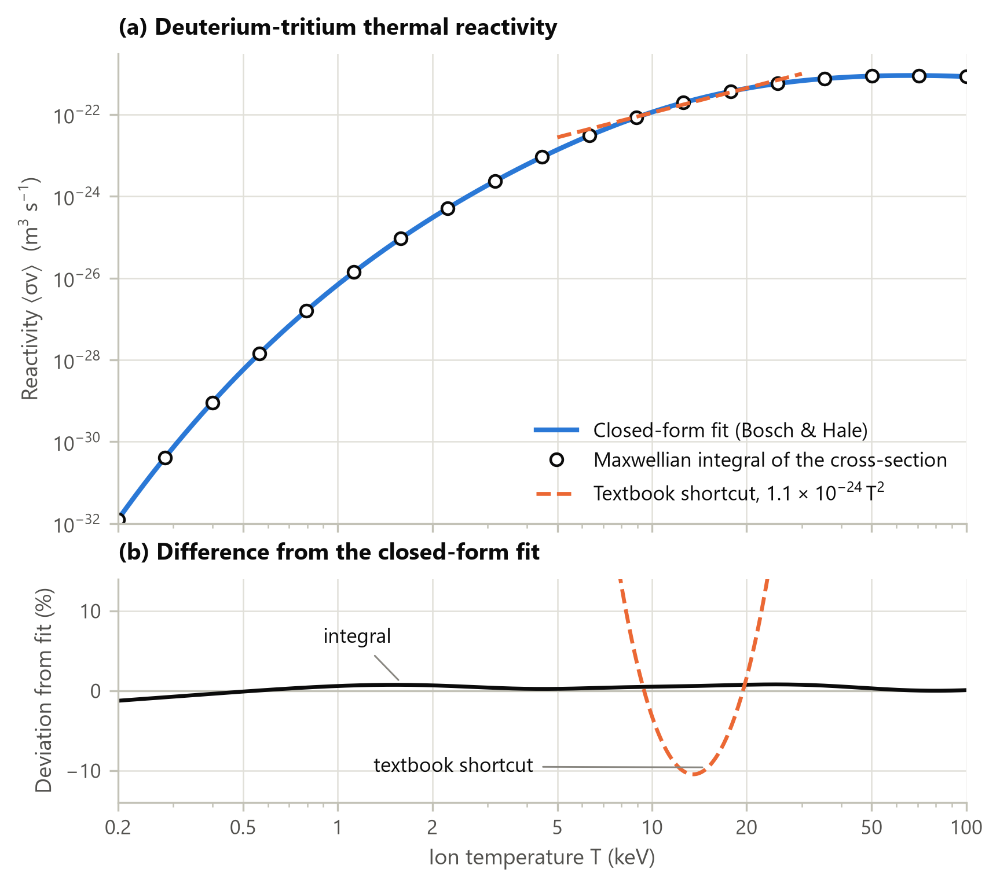
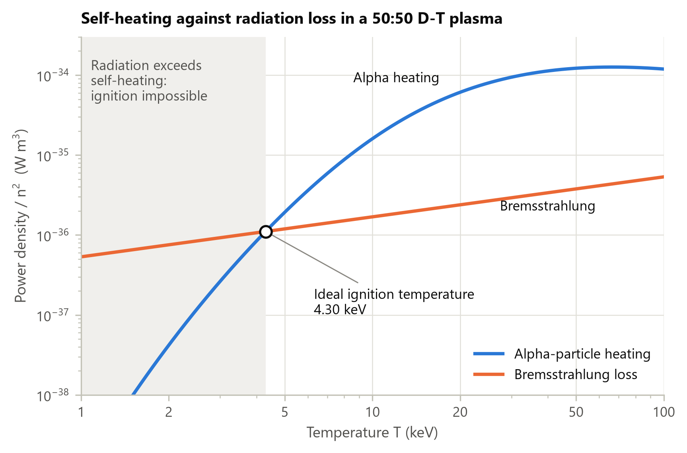
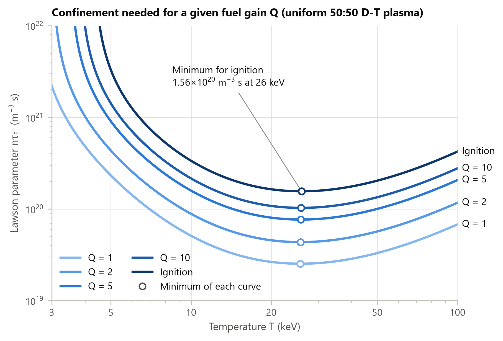
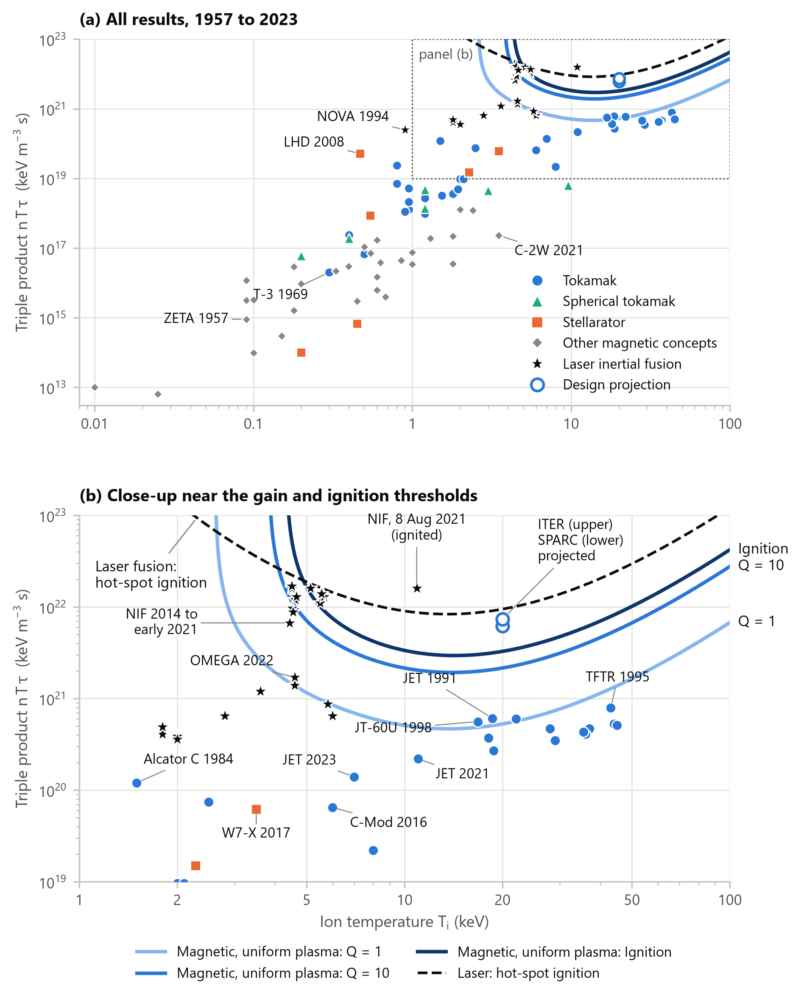
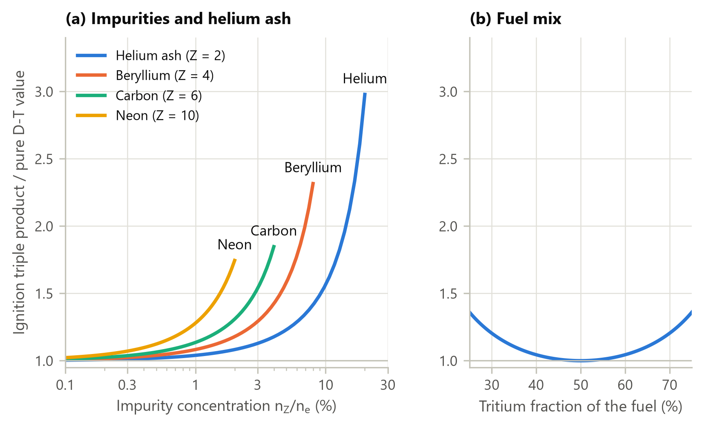

# The Lawson Criteria for Deuterium-Tritium Fusion: A Validated Reproduction and Sensitivity Analysis

**Ekorshi Paul Choudhury** 
Department of Mathematics and Computing, Sri Mata Vaishno Devi University 
Technical report

## Abstract

The Lawson criteria state how hot, how dense and how well confined a plasma must be for fusion to return more energy than is put in. This report presents an independent, tested Python implementation of those criteria for deuterium-tritium fuel. The implementation is validated in two ways: the thermal reactivity is computed by two independent routes that agree to within 0.8% from 0.5 to 100 keV, and the resulting thresholds reproduce the published values of Wurzel and Hsu to within 3%, including an ideal ignition temperature of 4.30 keV and a minimum ignition triple product of $2.95\times10^{21}$ keV m$^{-3}$ s. The model is then compared with 103 published results from 54 devices. Under a uniform-plasma idealisation, the best tokamak results reached about one fifth of the confinement needed for ignition, and the laser-fusion criterion singles out the one shot in the data set that is reported to have ignited. Finally, the model is extended to impure plasmas: 10% helium ash raises the ignition triple product by 57% and 2% carbon by 31%, while a 40:60 fuel mix costs only 4%.

## 1. Introduction

A fusion reactor must keep its fuel hot enough for nuclei to fuse and must lose heat slowly enough for the reactions to pay back the energy spent on heating. In 1957 Lawson expressed this as a condition on temperature $T$ and on the product of density and confinement time, $n\tau$ [1]. The closely related triple product $nT\tau$ is now the standard single-number measure of how close an experiment is to that goal.

Wurzel and Hsu reviewed these criteria in a consistent notation and compiled the values achieved by more than fifty experiments [3], with an update in 2025 [4]. Their work provides both a benchmark and a data set. This report has three aims:

1. to implement the criteria independently and verify the implementation against the published values;
2. to place the compiled experimental results against the calculated thresholds;
3. to quantify how the ignition threshold changes when the plasma is not pure 50:50 deuterium-tritium, and how much error a common textbook approximation introduces.

This is a reproduction with a small extension. It does not claim new physics.

## 2. Method

### 2.1 Thermal reactivity

The fusion rate per unit volume is $n_D n_T \langle\sigma v\rangle$, where the reactivity $\langle\sigma v\rangle$ is the cross-section times relative velocity averaged over a Maxwellian distribution. It is evaluated here with the closed-form fit of Bosch and Hale [2], valid from 0.2 to 100 keV.

As an independent check, the reactivity is also computed directly from the Bosch-Hale cross-section $\sigma(E)$ by numerical integration:

$$\langle\sigma v\rangle = \sqrt{\frac{8}{\pi\mu}}\,(kT)^{-3/2}\int_0^\infty \sigma(E)\,E\,e^{-E/kT}\,dE \tag{1}$$

where $\mu$ is the reduced mass and $E$ the centre-of-mass energy. The two routes use separate sets of fitted coefficients, so their agreement tests both.

### 2.2 Power balance

Consider a uniform plasma with electron and ion densities both equal to $n$, an equal mix of deuterium and tritium, and equal ion and electron temperatures $T$. The fusion power density is

$$S_F = \frac{n^2}{4}\,\langle\sigma v\rangle\,\varepsilon_F \tag{2}$$

with $\varepsilon_F = 17.6$ MeV per reaction. A fraction $f_c = 0.2$ is carried by the alpha particle and can heat the plasma; the rest leaves with the neutron. The plasma loses energy by bremsstrahlung radiation,

$$S_B = C_B\,n^2\,Z_{\mathrm{eff}}\,T^{1/2} \tag{3}$$

with $C_B = 5.34\times10^{-37}$ W m$^3$ keV$^{-1/2}$ [3], and by transport, at a rate equal to the thermal energy density $3nT$ divided by the energy confinement time $\tau_E$. In steady state the absorbed external heating $S_{\mathrm{abs}}$ plus alpha heating balances the losses:

$$S_{\mathrm{abs}} + f_c\,S_F = S_B + \frac{3nT}{\tau_E} \tag{4}$$

Defining the fuel gain $Q = S_F/S_{\mathrm{abs}}$ and solving for the Lawson parameter gives Eq. (16) of Ref. [3]:

$$n\tau_E = \frac{3T}{\left(f_c + Q^{-1}\right)\langle\sigma v\rangle\,\varepsilon_F/4 \;-\; C_B\,T^{1/2}} \tag{5}$$

Ignition is the limit $Q\to\infty$, in which alpha heating alone sustains the plasma. Multiplying Eq. (5) by $T$ gives the required triple product. Setting $\tau_E\to\infty$ in Eq. (4) with no external heating gives the *ideal ignition temperature*, below which radiation exceeds alpha heating and ignition is impossible however good the confinement.

### 2.3 Extension to impure plasmas

Real plasmas contain helium produced by the reactions and impurities from the walls. Let the plasma contain helium at a fraction $f_{\mathrm{He}} = n_{\mathrm{He}}/n_e$ of the electron density and one fully ionised impurity of charge $Z$ at a fraction $f_Z$, and let $x$ be the tritium fraction of the fuel. Charge neutrality fixes the fuel fraction $f_{DT} = 1 - 2f_{\mathrm{He}} - Zf_Z$, the total ion fraction $f_i = f_{DT} + f_{\mathrm{He}} + f_Z$ and the effective charge $Z_{\mathrm{eff}} = f_{DT} + 4f_{\mathrm{He}} + Z^2 f_Z$. Repeating the derivation of Section 2.2 gives

$$n_e\tau_E = \frac{\frac{3}{2}\left(1+f_i\right)T}{\left(f_c + Q^{-1}\right)x(1-x)\,f_{DT}^{2}\,\langle\sigma v\rangle\,\varepsilon_F \;-\; C_B\,Z_{\mathrm{eff}}\,T^{1/2}} \tag{6}$$

which reduces exactly to Eq. (5) for a pure, equal mix. Impurities act in three ways: they dilute the fuel (the factor $f_{DT}^2$), they increase radiation (the factor $Z_{\mathrm{eff}}$), and they change the number of particles to be kept hot (the factor $1+f_i$).

### 2.4 Laser fusion

In laser inertial fusion the fuel is confined only by its own inertia for a stagnation time $\tau_{\mathrm{stag}}$. For the onset of hot-spot ignition the 2025 update [4] gives

$$\left(n\tau_{\mathrm{stag}}\right)_{\mathrm{ig}} = \frac{2f_\alpha}{\theta_\alpha}\,\frac{12\,T}{\langle\sigma v\rangle\,\varepsilon_\alpha} \tag{7}$$

with $f_\alpha = 1.4$ from the criterion of Christopherson et al. [5] and $\theta_\alpha = 0.93$, the fraction of alpha energy deposited in the hot spot. Here $\varepsilon_\alpha = 3.52$ MeV.

### 2.5 Experimental data

All 103 experimental values (80 magnetic confinement, 23 laser) are transcribed from Tables 1 to 3 of Ref. [4], which lists the primary source for each. Two rows are design projections (ITER and SPARC). Magneto-inertial results from the Z Facility and one laser result without a reported ion temperature were not used. No experimental value was measured, inferred or adjusted in this work.

### 2.6 Implementation

The model is written in Python using NumPy, with Matplotlib for figures. A suite of 223 automated tests checks the physics against published values, checks limiting cases and inverse relations, and checks every data row for transcription errors by confirming that the tabulated Lawson parameter equals density times confinement time. One command regenerates every figure and number in this report.

## 3. Validation

### 3.1 Reactivity

Figure 1 compares the three evaluations of the reactivity. The closed-form fit and the direct integral of Eq. (1) agree to within 0.8% from 0.5 to 100 keV and to 1.3% at 0.2 keV. The residual reflects the fact that the two are separate fits to the same underlying nuclear data. The reactivity peaks at $8.95\times10^{-22}$ m$^3$ s$^{-1}$ near 67 keV.

**Figure 1.** (a) Deuterium-tritium thermal reactivity from the Bosch-Hale closed-form fit, from direct integration of the cross-section, and from the textbook quadratic approximation. (b) Percentage difference of the last two from the fit.

### 3.2 Ideal ignition temperature

Figure 2 shows alpha heating and bremsstrahlung loss per unit $n^2$. They cross at 4.30 keV, in agreement with the published 4.3 keV [3].

**Figure 2.** Alpha-particle heating and bremsstrahlung loss in a pure 50:50 D-T plasma. Below 4.30 keV radiation exceeds self-heating.

### 3.3 Gain and ignition thresholds

Figure 3 shows Eq. (5) for several values of the fuel gain. Table 1 compares the minima with the published values.

**Figure 3.** Lawson parameter required for fuel gains of 1, 2, 5 and 10 and for ignition, from Eq. (5). Circles mark the minimum of each curve.

**Table 1.** Calculated thresholds for a uniform 50:50 D-T plasma compared with Tables 2 and 3 of Ref. [3]. Lawson parameters are in m$^{-3}$ s and triple products in keV m$^{-3}$ s.

| Quantity | This work (fit) | This work (integral) | Published [3] |
|---|---|---|---|
| Ideal ignition temperature | 4.30 keV | | 4.3 keV |
| Minimum $n\tau_E$, $Q = 1$ | $2.52\times10^{19}$ at 25.7 keV | $2.50\times10^{19}$ at 25.7 keV | $2.5\times10^{19}$ at 26 keV |
| Minimum $n\tau_E$, ignition | $1.56\times10^{20}$ at 26.0 keV | $1.55\times10^{20}$ at 26.0 keV | $1.6\times10^{20}$ at 26 keV |
| Minimum $nT\tau_E$, $Q = 1$ | $4.67\times10^{20}$ at 13.7 keV | $4.64\times10^{20}$ at 13.7 keV | $4.6\times10^{20}$ at 14 keV |
| Minimum $nT\tau_E$, ignition | $2.95\times10^{21}$ at 14.2 keV | $2.93\times10^{21}$ at 14.3 keV | $2.9\times10^{21}$ at 14 keV |

All values agree with the published ones to within 3%, which is consistent with the two significant figures quoted in Ref. [3]. That reference integrates the cross-section numerically, so the "integral" column is the closer comparison; switching between the two reactivity routes changes the thresholds by less than 1%.

## 4. Results

### 4.1 Experiments against the criteria

Figure 4 places the 103 results against the calculated thresholds. Three points follow.

**Magnetic confinement.** No achieved result reaches the ignition curve. Measured as the achieved Lawson parameter divided by the value Eq. (5) requires at the same temperature, the highest results are JET shot 26087 in 1991 (19%), JT-60U shot E31872 in 1998 (18%) and JET shot 26095 in 1991 (17%). The high-temperature tokamak results of the 1990s lie along the $Q = 1$ curve.

**Laser fusion.** Applied to the 23 laser results, Eq. (7) places exactly one above threshold: NIF shot N210808 of 8 August 2021, at 1.75 times the required $n\tau_{\mathrm{stag}}$. The best earlier shot reached 0.86. This is the shot identified in Ref. [4] as having achieved hot-spot ignition, so the criterion separates it correctly from its predecessors. Later NIF shots reached a scientific gain of 1.5 in December 2022 [6] and 4.13 in April 2025 [4].

**Projections.** The design values for ITER and SPARC lie at 2.3 and 1.9 times the uniform-plasma ignition requirement. This should not be read as a prediction of ignition: Ref. [4] gives their stated missions as fuel gains of 10 and 2 respectively. The gap shows how optimistic the uniform-plasma model is when it is supplied with peak values, as discussed next.

**Figure 4.** Triple products of fusion experiments against ion temperature, with data from Ref. [4]. (a) All results. (b) Close-up of the dotted region. Solid curves are Eq. (5) multiplied by temperature; the dashed curve is Eq. (7) multiplied by temperature. Open circles are design projections.

**How far can the uniform model be trusted?** Inverting Eq. (5) gives the gain a uniform plasma would have at an experiment's measured temperature and Lawson parameter. Table 2 compares this with the measured scientific gain for six D-T shots that appear in both the plasma-parameter and gain tables of Ref. [4]. Two earlier shots that also appear in both tables, JET 26148 (1991) and TFTR 68522 (1992), are left out because they predate the full D-T campaigns of those machines, so their measured gain cannot be compared with a D-T-equivalent estimate.

**Table 2.** Uniform-plasma fuel gain from Eq. (5) compared with measured scientific gain for D-T tokamak shots. Measured values are from Table 4 of Ref. [4]; those for the 2021 and 2023 JET shots are averages over several seconds.

| Shot | Date | $T_i$ (keV) | Model $Q$ | Measured $Q_{\mathrm{sci}}$ |
|---|---|---|---|---|
| TFTR 76778 | 1994 | 44 | 0.36 | 0.28 |
| TFTR 80539 | 1994 | 36 | 0.36 | 0.27 |
| TFTR 83546 | 1995 | 43 | 0.56 | 0.16 |
| JET 42976 | 1997 | 28 | 0.63 | 0.63 |
| JET 99972 | 2021 | 11 | 0.41 | 0.38 |
| JET 104600 | 2023 | 7 | 0.19 | 0.11 |

The model agrees with two of the six to within 10% and overestimates the other four by factors of 1.3 to 3.5. An overestimate is the expected direction, for two reasons. The model applies peak density and temperature to the whole plasma, and Ref. [3] shows that realistic profiles raise the peak Lawson parameter needed for a given gain. In addition, the model gives a fuel gain, which is larger than the scientific gain by the fraction of heating power absorbed in the plasma, taken as 0.9 for magnetic confinement in Ref. [3]. The largest discrepancy is for TFTR shot 83546, for which Ref. [4] lists an ion temperature of 43 keV against an electron temperature of 12 keV, so the assumption of equal temperatures is also far from satisfied there. The uniform model is therefore a useful map of where experiments stand, not a predictor of their gain.

### 4.2 Sensitivity to composition

Figure 5 and Table 3 show how the minimum ignition triple product from Eq. (6) changes with composition, relative to the pure 50:50 value of $2.95\times10^{21}$ keV m$^{-3}$ s.

**Figure 5.** Minimum triple product for ignition relative to pure 50:50 D-T. (a) Against the concentration of helium ash or a low-Z impurity. (b) Against the tritium fraction of the fuel.

**Table 3.** Effect of composition on ignition, from Eq. (6). The penalty is the minimum ignition triple product divided by the pure 50:50 value.

| Case | $Z_{\mathrm{eff}}$ | Fuel fraction $f_{DT}$ | Ideal ignition temperature (keV) | Penalty |
|---|---|---|---|---|
| Pure 50:50 D-T | 1.00 | 1.00 | 4.30 | 1.00 |
| 5% helium | 1.10 | 0.90 | 4.73 | 1.23 |
| 10% helium | 1.20 | 0.80 | 5.26 | 1.57 |
| 20% helium | 1.40 | 0.60 | 6.81 | 2.98 |
| 2% beryllium | 1.24 | 0.92 | 4.85 | 1.18 |
| 1% carbon | 1.30 | 0.94 | 4.85 | 1.14 |
| 2% carbon | 1.60 | 0.88 | 5.43 | 1.31 |
| 0.5% neon | 1.45 | 0.95 | 4.99 | 1.12 |
| 1% neon | 1.90 | 0.90 | 5.67 | 1.28 |
| 45:55 fuel mix | 1.00 | 1.00 | | 1.01 |
| 40:60 fuel mix | 1.00 | 1.00 | | 1.04 |
| 30:70 fuel mix | 1.00 | 1.00 | | 1.20 |

Three observations follow. First, helium ash is tolerable at a few per cent but costly above about 10%: at 10% the penalty of 1.57 is close to the fuel-dilution factor $1/f_{DT}^2 = 1.56$ alone, which shows that dilution, not radiation, dominates for helium. Second, heavier impurities do more damage per ion: 1% neon costs about as much as 5 to 6% helium. Third, the fuel mix is forgiving near the optimum, with a 40:60 mix costing only 4%. Because only bremsstrahlung is included, the impurity penalties are lower bounds (Section 5).

### 4.3 Error of the textbook approximation

A widely used shortcut takes $\langle\sigma v\rangle \approx 1.1\times10^{-24}\,T^2$ m$^3$ s$^{-1}$ (with $T$ in keV) between 10 and 20 keV and neglects bremsstrahlung, which makes the ignition triple product a constant of about $3\times10^{21}$ keV m$^{-3}$ s [7]. With the constants used in this report that constant evaluates to $3.10\times10^{21}$ keV m$^{-3}$ s. Compared with the Bosch-Hale fit, the quadratic form deviates by up to 10.5% inside its stated window and fails quickly outside it, overestimating the reactivity by a factor of two at 5 keV and by 48% at 30 keV (Figure 1b). The resulting ignition threshold is 5% above the full calculation. Two errors partly cancel here: neglecting bremsstrahlung alone would lower the threshold by 6%. The shortcut is adequate for estimates near the optimum temperature and should not be used elsewhere.

## 5. Limitations

* **Uniform plasma.** Density and temperature are taken as constant in space and $T_i = T_e$. Real profiles are peaked, and Table 2 shows the consequence.
* **Radiation.** Only bremsstrahlung is included. Line radiation and synchrotron radiation are neglected, so the impurity penalties in Table 3 are lower bounds. Impurities are assumed fully ionised, which excludes high-Z wall materials such as tungsten.
* **Fuel.** Most experiments in the data set used hydrogen or deuterium; their positions in Figure 4 are D-T-equivalent values as given in Ref. [4].
* **Data.** Experimental values are taken as tabulated in Ref. [4] and carry that paper's assumptions, including values inferred from volume averages or from electron measurements.
* **Laser criterion.** Eq. (7) uses $\theta_\alpha = 0.93$, appropriate to NIF; Ref. [4] notes that the threshold shifts if this fraction differs.
* **Scope.** Only the D-T reaction is treated. Thermal distributions are assumed, so beam-driven fusion is not described.

## 6. Conclusions

An independent implementation of the Lawson criteria for D-T fuel reproduces the published thresholds to within 3%, with its reactivity confirmed by two separate calculations. Against 103 published results, the model shows that magnetic confinement has reached roughly one fifth of the confinement needed for ignition at reactor-relevant temperatures, and that the laser-fusion criterion correctly distinguishes the first ignited shot from those before it. Comparison with measured gains shows that the uniform-plasma idealisation is optimistic, by a factor of up to 3.5 for the shots examined. The extension to impure plasmas quantifies why helium exhaust and impurity control matter: 10% helium ash raises the ignition requirement by more than half.

Natural next steps are to replace the uniform plasma with prescribed density and temperature profiles, to add line radiation, and to use the model as the core of a zero-dimensional design study of a medium-size tokamak.

## Code and data availability

All code, data, tests and figures are available at https://github.com/anonnuserr/ignition-lab, and the interactive website built on the same model is at https://anonnuserr.github.io/ignition-lab/. The experimental data are from Ref. [4] and its open repository [8].

## Acknowledgements

The benchmark values and experimental data are the work of S. E. Wurzel and S. C. Hsu, whose open code [8] was used to confirm the reaction coefficients.

## References

1. J. D. Lawson, "Some criteria for a power producing thermonuclear reactor", Proc. Phys. Soc. B **70**, 6 (1957).
2. H.-S. Bosch and G. M. Hale, "Improved formulas for fusion cross-sections and thermal reactivities", Nucl. Fusion **32**, 611 (1992).
3. S. E. Wurzel and S. C. Hsu, "Progress toward fusion energy breakeven and gain as measured against the Lawson criterion", Phys. Plasmas **29**, 062103 (2022).
4. S. E. Wurzel and S. C. Hsu, "Continuing progress toward fusion energy breakeven and gain as measured against the Lawson criteria", Phys. Plasmas **32**, 112106 (2025).
5. A. R. Christopherson, R. Betti and J. D. Lindl, "Thermonuclear ignition and the onset of propagating burn in inertial fusion implosions", Phys. Rev. E **99**, 021201(R) (2019).
6. H. Abu-Shawareb et al., "Achievement of target gain larger than unity in an inertial fusion experiment", Phys. Rev. Lett. **132**, 065102 (2024).
7. J. Wesson, *Tokamaks*, 4th ed. (Oxford University Press, 2011).
8. S. E. Wurzel, lawson-criterion-paper, https://github.com/swurzel/lawson-criterion-paper (MIT licence).
